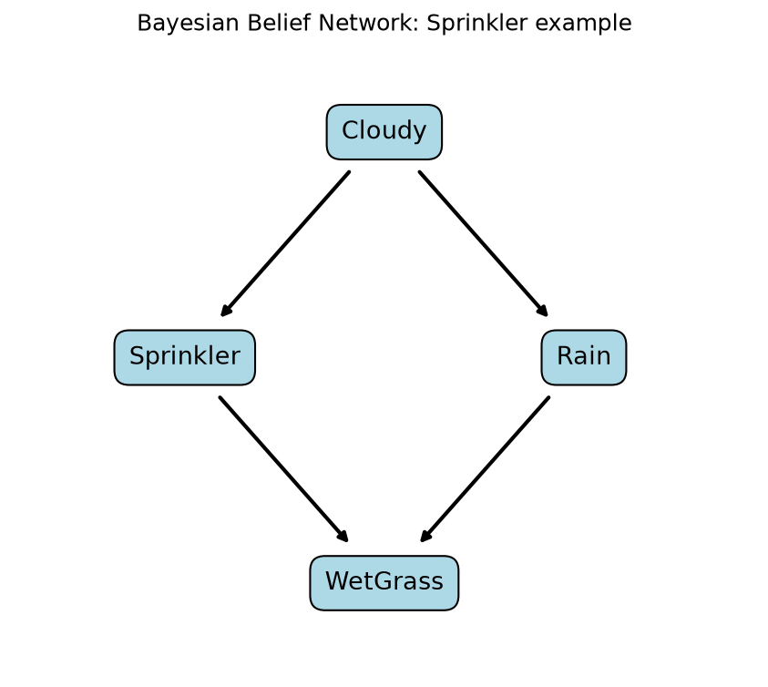

# Bayesian Belief Network

**Author:** Bakhtawar Ali

## Objective
To build a Bayesian Belief Network (a probabilistic graphical model), learn
its probabilities from data, and use it to answer probability questions.

## Algorithm in Simple Words
A Bayesian Belief Network is a graph where each node is a variable and each
arrow means "directly influences". Every node stores a table of probabilities
(CPT) given its parents. The probability of any full situation is the product
of these tables:

P(Cloudy, Sprinkler, Rain, WetGrass) =
P(Cloudy) x P(Sprinkler | Cloudy) x P(Rain | Cloudy) x P(WetGrass | Sprinkler, Rain)

## Network Structure
- Cloudy -> Sprinkler
- Cloudy -> Rain
- Sprinkler -> WetGrass
- Rain -> WetGrass



## Dataset
The Sprinkler network is a classic textbook example. The dataset
(`data/weather_data.csv`) is synthetic: 10,000 days generated from known
probabilities with a fixed random seed (42). 4 yes/no variables:
Cloudy, Sprinkler, Rain, WetGrass.
Split: 8,000 rows for training, 2,000 rows for testing.

## Method
1. **Structure:** defined by hand (the arrows above).
2. **Parameter learning:** each probability table is estimated by counting
   in the training data, with Laplace smoothing (alpha = 1).
3. **Inference:** exact inference by enumeration (adding up the joint
   probability of all worlds that match the evidence).

Implemented from scratch with pandas, numpy and matplotlib.

## How to Run (Mac)
```bash
git clone https://github.com/Bakhtawar560/bayesian-belief-network.git
cd bayesian-belief-network
python3 -m venv venv
source venv/bin/activate
pip install -r requirements.txt
python3 src/bayesian_network.py
```

## Results

Learned probabilities were very close to the true ones, for example
P(Rain | Cloudy=1) learned 0.807 vs true 0.80.

| Question | Learned | True |
|---|---|---|
| P(Rain) | 0.501 | 0.500 |
| P(Rain given WetGrass) | 0.703 | 0.708 |
| P(Rain given WetGrass and Sprinkler on) | 0.309 | 0.320 |
| P(Sprinkler given WetGrass) | 0.429 | 0.430 |
| P(WetGrass given Cloudy) | 0.750 | 0.745 |

Prediction test: predicting Rain from Cloudy, Sprinkler and WetGrass on
2,000 unseen days gave **90.55%** accuracy, compared with 50.80% for
always guessing the most common answer.

Interesting result ("explaining away"): seeing wet grass raises the chance of
rain to 0.70, but if we also know the sprinkler was on, it drops to 0.31,
because the sprinkler already explains the wet grass.

